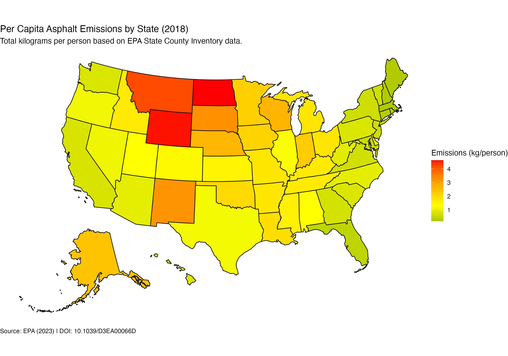

# Per Capita Asphalt Emissions by State (2018)

This project visualizes per-capita asphalt emissions across U.S. states using the EPA's 2018 State County Inventory (DOI: 10.1039/D3EA00066D).

## Visual



## Citations

- **Data:** U.S. EPA 2018 State County Inventory (pasteur.epa.gov)
- **Research:** Anthropogenic secondary organic aerosol and ozone production from asphalt-related emissions, *Environ. Sci.: Atmos.*, 2023, 3, 1221-1230. https://doi.org/10.1039/D3EA00066D

## Project Structure

```text
.
├── data/               # Raw EPA Excel files
├── plots/              # Generated choropleth maps
├── emissions_map.R     # Main processing script
└── README.md           # Project documentation
```
